# CareAgent 架构流程图

> 适用版本：v1.0.0 ｜ 按真实代码整理，图与文件对应关系见文末「图与代码对照表」。
> 图为 Mermaid，GitHub、VS Code（Mermaid 插件）、Typora 等均可直接渲染。
> 图内标签统一写成「中文名（English）」中英并列：前半段给人看，括号里是代码里的标识，方便对照源码。

## 目录

1. [系统分层总览](#一系统分层总览)
2. [请求入口与路由](#二请求入口与路由)
3. [评估智能体（并行评审）](#三评估智能体并行评审)
4. [SOP 问答智能体（快慢分层 + 检索增强）](#四sop-问答智能体快慢分层--检索增强)
5. [告警研判智能体（人工审批）](#五告警研判智能体人工审批)
6. [作业流程智能体（状态机）](#六作业流程智能体状态机)
7. [记忆与断点恢复（含检查点清理时机）](#七记忆与断点恢复)
8. [数据落库与多租户贯穿](#八数据落库与多租户贯穿)

## 一、系统分层总览

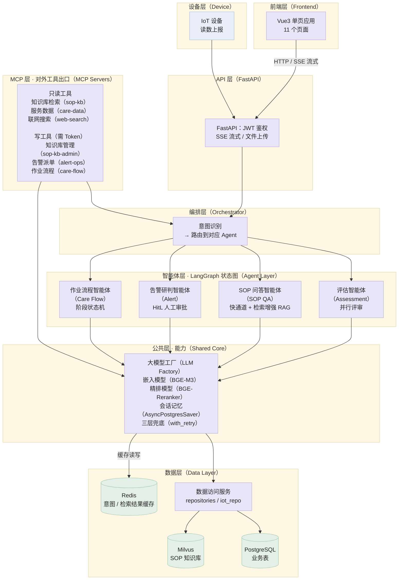

### 各层职责与代码位置

| 层 | 职责 | 代码 |
|---|---|---|
| 前端层（Frontend） | 11 个页面单页应用（含登录页），流式输出消费，接口代理 | `frontend/src/` |
| API 层（FastAPI） | 路由、身份鉴权、流式响应、文件上传 | `backend/api/v1/`、`backend/dependencies.py` |
| MCP 层（MCP Servers） | 把作业能力暴露成标准 MCP 工具：只读=知识库检索（sop-kb）/服务数据（care-data）/联网搜索（web-search）；写=知识库管理（sop-kb-admin）/告警派单（alert-ops）/作业流程（care-flow，需 Token + 租户白名单） | `backend/mcp/`、[MCP 文档](mcp.md) |
| 编排层（Orchestrator） | 意图识别（`classify_intent`）、单智能体（SINGLE）/流水线（PIPELINE）路由、歧义澄清（CLARIFY） | `backend/core/orchestrator.py`、`backend/core/intent.py` |
| 智能体层（Agent Layer） | 4 张 LangGraph 状态图（各自模式不同） | `backend/agents/` |
| 公共层（Shared Core） | 大模型工厂、嵌入/精排模型、会话记忆、三层兜底 | `backend/core/` |
| 数据层（Data Layer） | 租户守卫的落库与查询、向量检索、结果缓存（意图识别 + SOP 检索，Redis 不可用自动旁路） | `backend/db/`、`backend/core/knowledge_base.py`、`backend/core/cache.py` |

说明：前端到后端是「HTTP 请求 + SSE 流式回传」。MCP 层是并行的对外出口：外部系统按 MCP 协议调用同一批作业能力（告警派单工具会触发编排层的告警智能体，只读工具复用公共层与数据层），详见 [MCP 文档](mcp.md)。

## 二、请求入口与路由

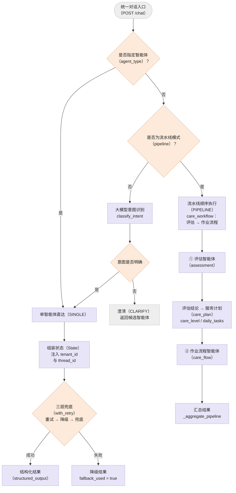

各智能体的单次调用超时（`_AGENT_TIMEOUT`）：评估 300 秒（五维并行 + 诊断 + 总结），作业流程 180 秒，告警与 SOP 问答各 120 秒。

### 请求入口一览

| 入口 | 方法 | 说明 |
|---|---|---|
| `/api/v1/auth/login` | POST | 登录签发 JWT（sub / role / tenant_id） |
| `/api/v1/chat` | POST | 统一对话，SSE 流式，由编排层自动路由 |
| `/api/v1/chat/session/{elder_id}/{session_id}` | DELETE | 删除整个会话线程的检查点（仅 admin、仅本租户点位；含暂停中的断点） |
| `/api/v1/assessment/upload` | POST | 上传评估表，触发评估智能体 |
| `/api/v1/assessment/{id}` | GET | 查询评估结果（`assessment_results`） |
| `/api/v1/assessment/{id}/export` | GET | 导出评估报告 Word（.docx） |
| `/api/v1/sop-qa/chat` | POST | SOP 问答，SSE 流式 |
| `/api/v1/knowledge/search` | POST | 作业规范 语义搜索（混合召回 + 精排，带置信度） |
| `/api/v1/alert/trigger` | POST | 触发告警研判，返回待审核数据 |
| `/api/v1/alert/{id}/review` | GET | 值班主管读取待审核内容 |
| `/api/v1/alert/{id}/confirm` | POST | 值班主管确认后恢复流程执行 |
| `/api/v1/care-flow/start` | POST | 开启作业流程会话 |
| `/api/v1/care-flow/chat` | POST | 作业流程多轮对话，SSE 流式 |
| `/api/v1/care-flow/{sid}/report` | GET | 查询服务报告（`care_flow_reports`） |
| `/api/v1/care-flow/{sid}/report/export` | GET | 导出服务报告 Word（.docx） |
| `/api/v1/devices/{id}/readings` | POST | 设备读数上报（租户校验） |
| `/api/v1/devices/elder/{id}/readings` | GET | 设备读数查询 |

## 三、评估智能体（并行评审）  

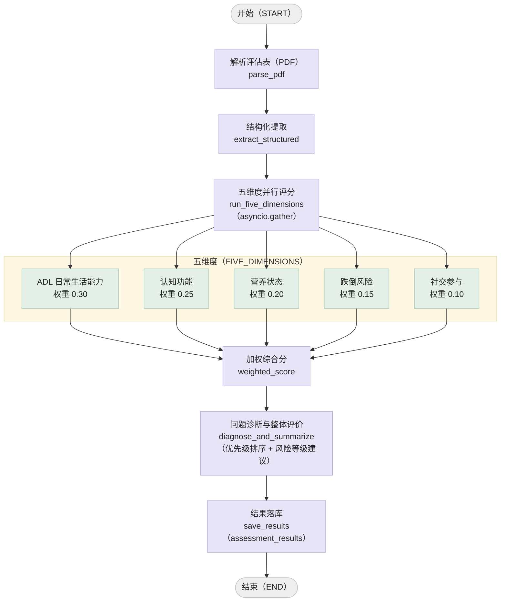

特点：线性链路、无分支、无中断（`interrupt`）、不挂断点存档（`checkpointer`），一次性任务无需恢复；性能关键路径是五维并行。

## 四、SOP 问答智能体（快慢分层 + 检索增强）

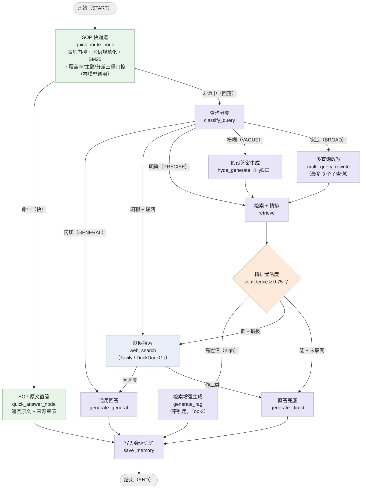

### 检索链路

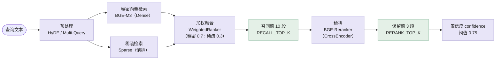

降级策略（任一环节异常都不会抛到接口）：检索异常 → 空结果 + confidence 0 → 走直答兜底；开启联网时先联网再直答。检索全程带 `tenant_id` 过滤；命中 Redis 缓存时直接返回（同问实测 2.01 秒 → 0.008 秒）。

快通道与慢链路的分工：快通道（`backend/core/quick_index.py`，索引在 `data/quick_index/entries.json`）只负责"知识库里有明确章节的标准问法"，
命中即返回 SOP 原文与来源章节，端到端约 3 毫秒且不调模型不查库；判断没把握（覆盖率 / 主题词 / 分差三重门控任一不过）就回落上面这条慢链路，
宁可慢一点也不猜。回归用例 `data/quick_index/golden.jsonl`（调参集）与 `golden_holdout.jsonl`（留出集），跑 `scripts/evaluate_quick_channel.py` 验证。

## 五、告警研判智能体（人工审批）

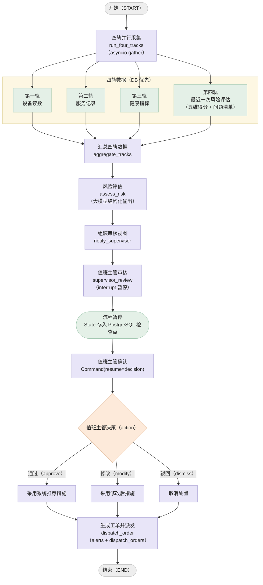

四轨采集优先读数据库里的真实读数与记录（`iot_repo`），并按设备类型（`device_types`）过滤指标；
读不到就记为「证据缺失」显式交给研判（缺证据不得判低风险），不再用模拟数据兜底，
因此既不会被"没有真实设备"卡住，也不会伪造证据。
第四轨（最近一次风险评估）来自 `assessment_results` 表，按 `elder_id + tenant_id` 取最新一条；
它回答的是"这个人本来有多脆弱"——跌倒高风险、ADL 低分的点位，同样的心率异常要按更高等级处理；
没有评估记录时返回 `None`，按"无第四轨"继续，不算失败（`run_four_tracks` 用 `asyncio.gather(return_exceptions=True)`，
任一轨异常都不阻塞其他轨）。

### 人工审批时序

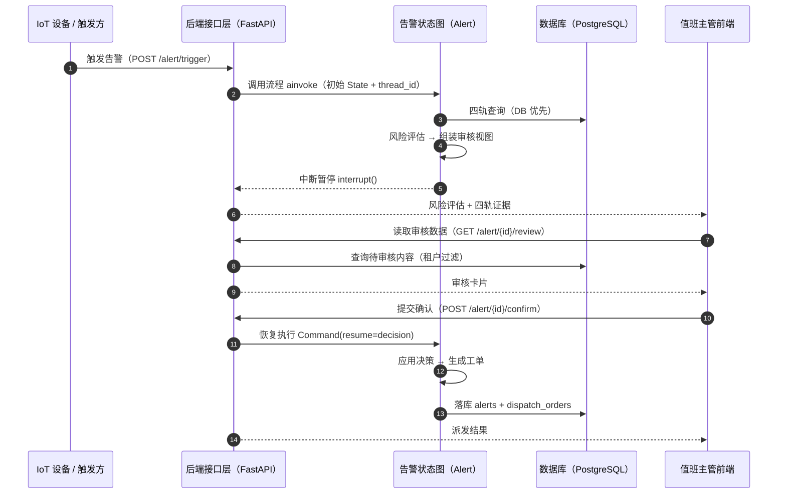

## 六、作业流程智能体（状态机）

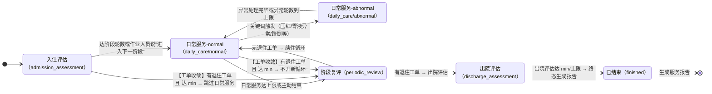

> 关键设计：`discharge_order`（退住工单）是 care_flow state 的一个字段，表示**业务系统（SaaS）下发的"该点位办理退住/出院"指令**——"谁可以决定出院"是服务组织权限（医务/财务/家属流程走完后由 SaaS 统一下发），不由一线作业人员在对话里口头决定。结构为 dict（可带 `order_id` / `reason` / `issued_by` 等字段，状态机只判"有无"、不读内容），可由 `/start` 或每轮 `/chat` 注入（模拟 SaaS 随时下发）。
> 一旦写入即随 checkpointer 跨轮持久。**工单驱动阶段收敛**：`check_stage_node` 每轮判断 `bool(discharge_order) and reached_min and not in_abnormal`，满足即由 `_converge_under_discharge` 路由——入住评估 / 日常服务 → 阶段复评、复评 → 出院评估、出院评估 → FINISHED（保证必经复评、不直接跳终态；异常子模式内暂缓收敛）。**总轮数上限（max_turns）压过 discharge_order**——到上限必须停，下一会话再续。

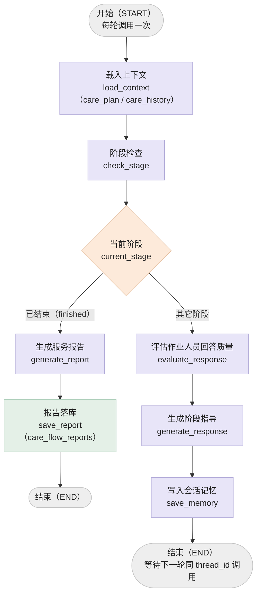

### 阶段轮数控制

| 阶段 | 最少轮数 | 最多轮数 | 说明 |
|---|---|---|---|
| 入住评估（admission_assessment） | 3 | 8 | 收集基础信息与风险评估 |
| 日常服务（daily_care） | 8 | 15 | 主阶段，内含异常子模式 |
| ├─ normal 子模式 | — | — | 默认模式，常规服务指导 |
| ├─ abnormal 子模式 | 2 | 6 | 关键词触发，异常处置指导 |
| 阶段复评（periodic_review） | 3 | 6 | 复盘服务效果 |
| 出院评估（discharge_assessment） | 2 | 5 | 出院前评估 |
| 已结束（finished） | — | — | 触发报告生成后结束 |

流转触发条件（任一满足即进入下一阶段）：达到该阶段最大轮数（`STAGE_MAX_TURNS`）；作业人员输入"结束服务 / 进入下一阶段 / 阶段完成"等关键词且已达最少轮数（`STAGE_MIN_TURNS`）；**有退住工单且已达最少轮数**（`discharge_converge`，见下）；总轮数达到上限（默认 40 轮，**压过 discharge_order**——必须停，不能继续往出院评估走）。

**退住工单（`state.discharge_order`）驱动的阶段收敛**：
- 触发条件：`bool(discharge_order) and reached_min and not in_abnormal` —— 有工单、当前阶段达 min、且不在异常子模式；
- 收敛去向（`_converge_under_discharge`）：入住评估 / 日常服务 → 阶段复评；复评 → 出院评估；出院评估 → FINISHED（SaaS 发起的少数业务事件，靠工单驱动、不是轮数硬推）；
- 保证必经一次阶段复评（离院前综合评估），不直接跳终态；异常子模式内不收敛；
- 无工单 → 阶段复评后回日常服务、清零阶段轮数开新循环（项目现场常态是点位长期住着，"出院"不该由轮数强制）。

### 闭环：Agent → SaaS 出站通知

这是全项目统一的**下行通道**：业务系统发起信号 → Agent 执行 → 终态结果主动推回业务系统（而不是让 SaaS 轮询）。目前两个来源共用同一张发件箱：

| 来源 | 触发点 | 事件类型 | 幂等键 |
|---|---|---|---|
| 作业流程 | `save_report` 节点 | `care_flow.finished` | `session_id` |
| 告警研判 | `dispatch_order` 节点（值班主管确认后） | `alert.dispatched` / `alert.dismissed` | `order_id` |

以作业流程为例（告警链路同构，只是触发点与事件名不同）：

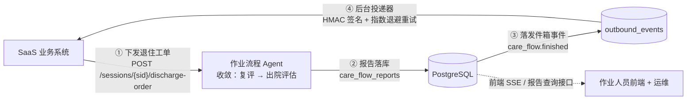

| 环节 | 实现 | 关键取舍 |
|---|---|---|
| 事件产生 | `save_report_node` 调 `enqueue_care_flow_finished` | 与报告落库同一时点触发，事件必带完整报告 |
| 落库去向 | `outbound_events`（发件箱） | 先持久化再投递——进程崩溃不丢事件，重启后续投 |
| 投递 | `backend/core/outbound.py` 后台循环（默认 15s 一轮） | 不阻塞作业流程；外部系统抖动不影响图执行 |
| 可靠投递 | 2xx 成功；失败 30s → 120s → 600s → 1800s 退避，5 次后置 `failed` | 「至少一次」语义，消费端用 `X-CareAgent-Event-Id` 去重 |
| 安全 | `X-CareAgent-Signature: sha256=HMAC-SHA256(secret, body)` | 密钥按租户配置（`tenant_webhooks`），未配置则不下发签名头 |
| 幂等 | `(event_type, aggregate_id)` 唯一索引 | 流程重跑 `save_report` 不会重复通知 SaaS |
| 未配地址 | 事件保留 `pending`、不计尝试次数 | 配好回调地址后自动补投，无需手工重放 |

配置与审计：`PUT/GET /api/v1/care-flow/webhooks` 管理回调地址（限 supervisor / admin），`GET /api/v1/care-flow/events` 查看投递状态，`POST /api/v1/care-flow/events/{id}/redeliver` 人工重投。

## 七、记忆与断点恢复

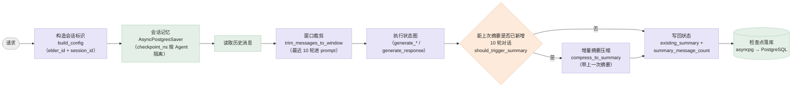

断点存档（checkpointer）统一走 `backend/core/memory.py` 的 `get_memory_saver`：默认 `AsyncPostgresSaver`，检查点写进业务库同库的 `checkpoints` / `checkpoint_blobs` / `checkpoint_writes` 三张表，**进程重启后多轮历史与告警中断点都还在**（实测跨进程恢复：A 进程跑到 interrupt 退出，B 进程用同一 thread_id 恢复并派单）；连不上库且配置为 `auto` 时回落进程内 `MemorySaver`（`CHECKPOINT_BACKEND=postgres` 可强制不许回落）。同一 thread_id 下按 `checkpoint_ns = agent_type` 隔离命名空间，避免统一对话入口下多个 Agent 共用 session_id 时互相覆盖断点。评估智能体不挂 checkpointer，因为它是无状态的一次性任务。

上下文控制分两级，都是"最近窗口 + 增量摘要"：

- **窗口裁剪**：`trim_messages_to_window`（默认 10 轮）——SOP 问答在 `generate_general` 里裁，作业流程在 `generate_response` 里裁；系统消息永远保留，不参与裁剪；
- **增量摘要**：`save_memory` 节点判断"距上次摘要是否已新增 10 轮"（`should_trigger_summary`，比较的是新增轮数，不是消息总数取模），满足就调 `compress_to_summary`，并把结果**写回 `existing_summary`**，同时记下 `summary_message_count`。
  写回是关键：摘要随检查点落库，下一轮（乃至重启后）的生成节点会把 `【作业人员历史摘要】` 拼进系统提示；只算不写回等于每轮从零开始、还白花一次 LLM 调用。
  长会话稳定每 10 轮压一次，短会话不压；压缩失败只记警告、保留旧摘要，不打断回答。

### 检查点的清理时机

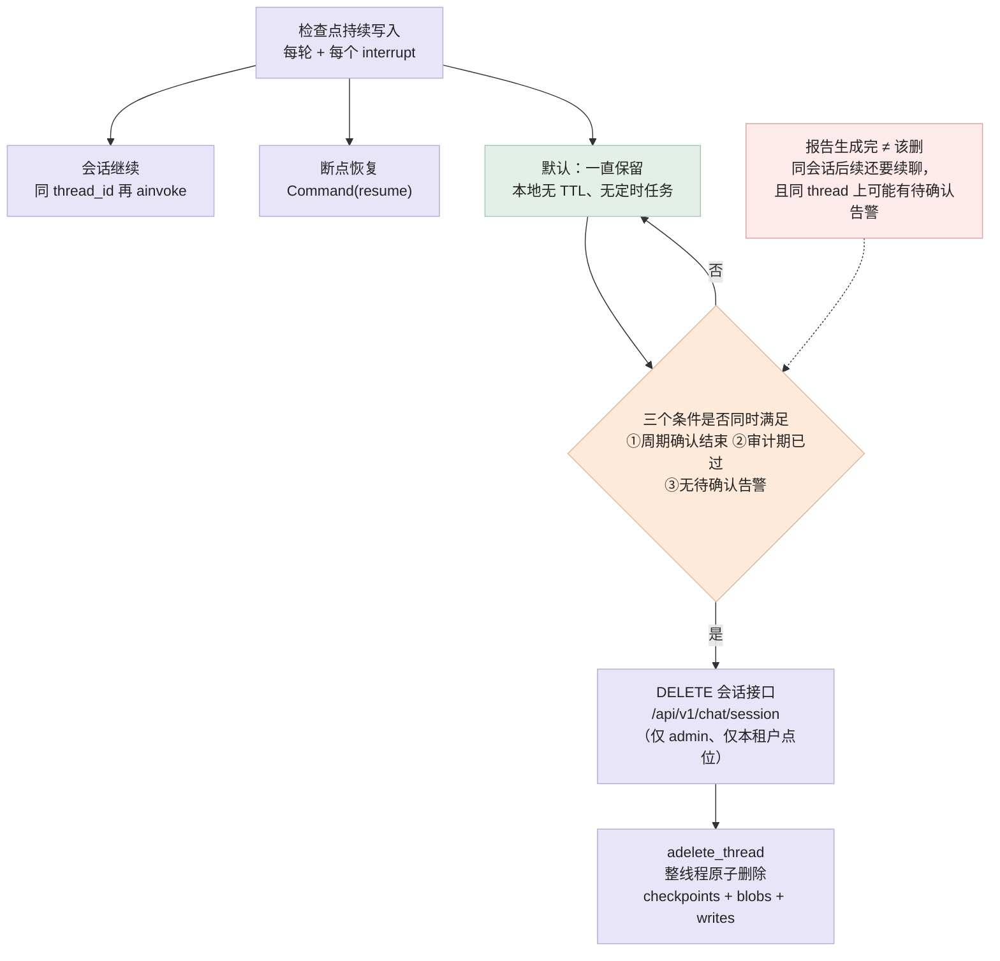

清理是**手动触发**的，只有一个入口：管理员调 `DELETE /api/v1/chat/session/{elder_id}/{session_id}`
（底层 `adelete_thread`，按 thread 整体生效）。删除会连带清掉该 thread 上所有 Agent 命名空间的检查点，
包括"等值班主管确认"的告警断点，所以判定条件写成三条同时满足：周期确认结束、审计期已过、没有待确认告警。
**不挂在"作业流程生成报告之后"**：同一 session 是"每轮跑完 → END → 同 thread_id 再 ainvoke"，
报告只是一种收尾方式，删早了会话记忆会断片；报告本身落在 `care_flow_reports` 业务表，不依赖检查点。
需要批量保留策略时，按"业务状态 + 最后更新时间"生成待删清单（先 dry-run 打印，再执行），
而不是在业务节点里顺手删。

## 八、数据落库与多租户贯穿

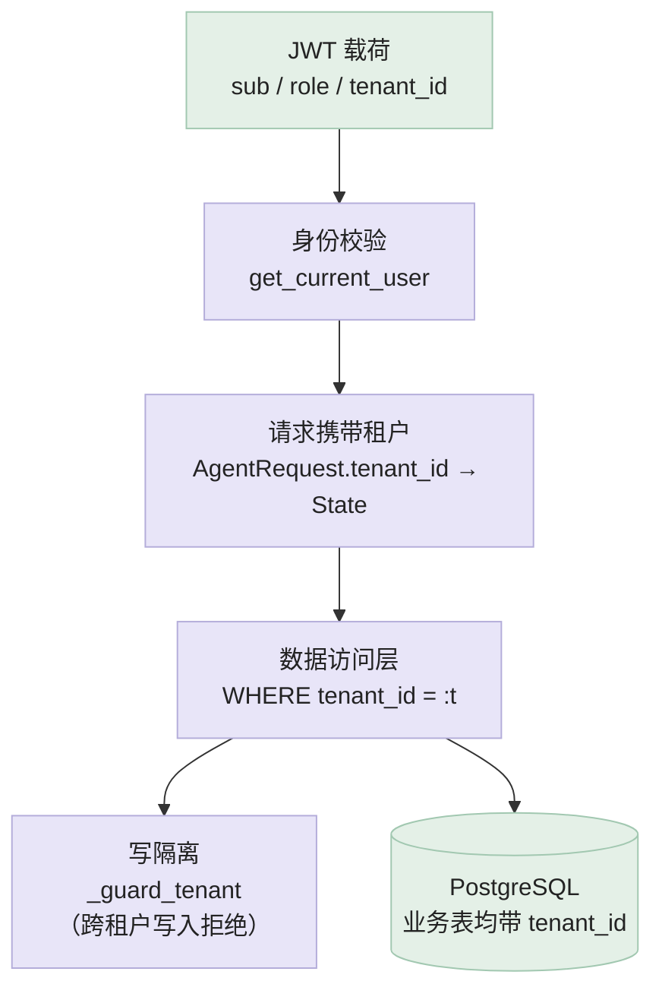

| 表 | 写入方 | 查询接口 |
|---|---|---|
| `assessment_results` | 评估智能体 `save_results` | `GET /api/v1/assessment/{id}` |
| `care_flow_reports` | 作业流程 `save_report` | `GET /api/v1/care-flow/{sid}/report` |
| `alerts` + `dispatch_orders` | 告警智能体 `dispatch_order` | `GET /api/v1/alert/{id}/review` |
| `device_readings` | `POST /api/v1/devices/{id}/readings` | `GET /api/v1/devices/elder/{id}/readings` |

跨租户读请求统一按"数据不存在"处理（404 或空列表），而不是 403，避免泄漏"该 ID 是否存在"。

## 图与代码对照表

| 图 | 对应代码 |
|---|---|
| 系统分层总览 | `frontend/src/`、`backend/api/router.py`、`backend/mcp/`、`backend/core/orchestrator.py`、`backend/agents/*`、`backend/core/`、`backend/db/` |
| 请求入口与路由 | `backend/core/orchestrator.py`（`execute` / `_run_single_agent` / `_run_pipeline` / `_classify_intent`）、`backend/core/intent.py` |
| 评估智能体 | `backend/agents/assessment/graph.py`、`nodes.py`（`FIVE_DIMENSIONS`、`run_five_dimensions_node`） |
| SOP 问答智能体 | `backend/agents/sop_qa/graph.py`、`nodes.py`（快通道入口 + 检索常量与置信度路由）、`backend/core/quick_index.py`、`backend/core/knowledge_base.py`、`backend/core/reranker.py`、`backend/core/retrieval_cache.py`、`data/quick_index/` |
| 告警研判智能体 | `backend/agents/alert/graph.py`、`nodes.py`（四轨与 `interrupt`）、`backend/api/v1/alert.py`、`backend/db/iot_repo.py` |
| 作业流程智能体 | `backend/agents/care_flow/graph.py`、`nodes.py`（`STAGE_ORDER` / `STAGE_MAX_TURNS`）、`state.py` |
| 记忆与断点 / 清理 | `backend/core/memory.py`（`get_memory_saver` / `delete_thread_state`）、`backend/api/v1/unified_chat.py`（清理接口） |
| 落库与多租户 | `backend/db/repositories.py`、`backend/db/iot_repo.py`、`backend/db/migrations.py` |
